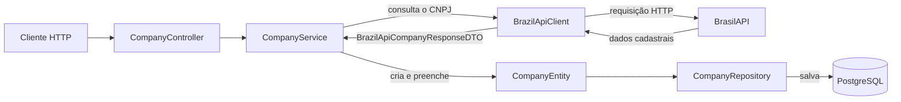

<p align="center">
  
</p>

# API de Cadastro de Empresas

API REST para cadastrar e gerenciar empresas a partir do CNPJ. A aplicação consulta os dados cadastrais na [BrasilAPI](https://brasilapi.com.br/), permite definir o tipo de relacionamento com cada empresa e mantém as informações em um banco PostgreSQL.

## Sobre o projeto

O projeto centraliza informações de empresas com as quais uma organização se relaciona. Cada cadastro pode ser classificado como cliente, fornecedor, parceiro ou prospect, facilitando a consulta e a manutenção desses registros por meio de endpoints HTTP.

No cadastro, basta informar o CNPJ e o tipo de relacionamento. A API busca automaticamente razão social, nome fantasia, município, UF e situação cadastral na BrasilAPI antes de salvar o registro. Também é possível listar empresas, consultar uma empresa por CNPJ, alterar seu relacionamento e excluir o cadastro.

## Tecnologias

- Java 21
- Spring Boot 4
- Spring Web MVC
- Spring Data JPA
- Spring Cloud OpenFeign
- PostgreSQL
- Docker
- Docker Compose
- Lombok
- Maven

## Como a aplicação funciona



No fluxo de cadastro, a BrasilAPI devolve os dados cadastrais ao cliente de integração. O service usa esse retorno e o tipo de relacionamento informado na requisição para montar a `CompanyEntity`; somente depois a entidade é enviada ao repository e persistida no PostgreSQL.

A aplicação está organizada nas seguintes responsabilidades:

- **Controller:** recebe as requisições HTTP e devolve as respostas da API.
- **Service:** concentra as regras de negócio e coordena as integrações.
- **Repository:** realiza a persistência e a consulta das empresas.
- **DTOs:** definem os dados de entrada, saída e integração externa.
- **Exception Handler:** padroniza as respostas de erro da aplicação.

## Pré-requisitos

Para executar toda a aplicação em contêineres, instale:

- Docker Engine ou Docker Desktop
- Docker Compose v2

Java 21, Maven 3.9 ou superior e PostgreSQL só precisam estar instalados no host caso você opte pela execução local, sem Docker.

Também é necessário acesso à internet para consultar a BrasilAPI durante o cadastro de uma empresa.

## Executar com Docker

Esta é a forma recomendada de iniciar o projeto. Na raiz do repositório, crie o arquivo local de variáveis de ambiente a partir do modelo:

```bash
cp .env.example .env
```

Defina uma senha em `DATABASE_PASSWORD` e, se desejar, altere o nome do banco, o usuário ou a porta da API:

```dotenv
DATABASE_NAME=companyregistry
DATABASE_USERNAME=companyregistry
DATABASE_PASSWORD=troque-por-uma-senha-local
APP_PORT=8080
```

Depois, construa as imagens e inicie a API e o PostgreSQL:

```bash
docker compose up --build -d
```

A API ficará disponível em `http://localhost:8080`, ou na porta definida em `APP_PORT`. O Compose aguarda o health check do PostgreSQL antes de iniciar a aplicação, e o banco não é exposto para fora da rede interna dos contêineres.

Comandos úteis:

```bash
# Acompanhar os logs da API
docker compose logs -f app

# Encerrar os contêineres sem apagar os dados
docker compose down

# Encerrar os contêineres e apagar o volume do banco
docker compose down -v
```

Os dados permanecem no volume `postgres_data` após um `docker compose down`. As credenciais do PostgreSQL são aplicadas na primeira criação desse volume; para reinicializar o banco com novas credenciais, remova o volume com `docker compose down -v` e suba os serviços novamente.

O `.env` contém configurações locais e é ignorado pelo Git e pelo build do Docker. O arquivo `.env.example` deve permanecer apenas como modelo, sem senhas reais.

## Executar localmente

Para executar sem Docker, tenha Java 21, Maven 3.9 ou superior e PostgreSQL instalados.

### Configuração do banco de dados

Crie um banco PostgreSQL chamado `desingpatterns`:

```sql
CREATE DATABASE desingpatterns;
```

Defina as credenciais de acesso por meio das variáveis de ambiente:

```bash
export DATABASE_USERNAME=seu_usuario
export DATABASE_PASSWORD=sua_senha
```

No PowerShell:

```powershell
$env:DATABASE_USERNAME="seu_usuario"
$env:DATABASE_PASSWORD="sua_senha"
```

A configuração atual usa `spring.jpa.hibernate.ddl-auto=update`, que atualiza o esquema do banco ao iniciar a aplicação.

Clone o repositório, acesse a pasta do projeto e execute:

```bash
mvn spring-boot:run
```

A API ficará disponível, por padrão, em:

```text
http://localhost:8080
```

Para executar os testes:

```bash
mvn test
```

## Endpoints

A rota base da API é `/v1/companies`.

| Método | Endpoint | Descrição | Resposta de sucesso |
| --- | --- | --- | --- |
| `GET` | `/v1/companies` | Lista todas as empresas cadastradas | `200 OK` |
| `GET` | `/v1/companies/{cnpj}` | Busca uma empresa pelo CNPJ | `200 OK` |
| `POST` | `/v1/companies` | Consulta a BrasilAPI e cadastra uma empresa | `201 Created` |
| `PATCH` | `/v1/companies/relationship-type` | Atualiza o tipo de relacionamento | `202 Accepted` |
| `DELETE` | `/v1/companies/{cnpj}` | Exclui uma empresa | `204 No Content` |

### Cadastrar uma empresa

Os tipos de relacionamento aceitos são:

- `CLIENTE`
- `FORNECEDOR`
- `PARCEIRO`
- `PROSPECT`

```bash
curl --request POST \
  --url http://localhost:8080/v1/companies \
  --header 'Content-Type: application/json' \
  --data '{
    "cnpj": "00000000000191",
    "tipoRelacionamento": "CLIENTE"
  }'
```

O CNPJ é utilizado para consultar os dados da empresa na BrasilAPI. Em caso de sucesso, a API responde com `201 Created` e sem corpo.

### Listar todas as empresas

```bash
curl --request GET \
  --url http://localhost:8080/v1/companies
```

Exemplo de resposta:

```json
[
  {
    "cnpj": "00000000000191",
    "razaoSocial": "EMPRESA EXEMPLO S.A.",
    "nomeFantasia": "EMPRESA EXEMPLO",
    "municipio": "BRASILIA",
    "uf": "DF",
    "situacaoCadastral": "ATIVA",
    "tipoRelacionamento": "CLIENTE"
  }
]
```

### Buscar uma empresa pelo CNPJ

```bash
curl --request GET \
  --url http://localhost:8080/v1/companies/00000000000191
```

Quando a empresa não está cadastrada, a aplicação responde com `404 Not Found`.

### Atualizar o tipo de relacionamento

```bash
curl --request PATCH \
  --url http://localhost:8080/v1/companies/relationship-type \
  --header 'Content-Type: application/json' \
  --data '{
    "cnpj": "00000000000191",
    "tipoRelacionamento": "FORNECEDOR"
  }'
```

Em caso de sucesso, a API responde com `202 Accepted` e sem corpo.

### Excluir uma empresa

```bash
curl --request DELETE \
  --url http://localhost:8080/v1/companies/00000000000191
```

Em caso de sucesso, a API responde com `204 No Content`.

## Tratamento de erros

A aplicação pode retornar os seguintes códigos:

| Código | Situação |
| --- | --- |
| `404 Not Found` | Empresa não encontrada no banco local |
| `409 Conflict` | Empresa já cadastrada |
| `500 Internal Server Error` | Erro inesperado ou falha não tratada em uma integração |

Formato atual da resposta de erro:

```json
{
  "messagem": "Empresa não encontrada!",
  "code": 404
}
```

## Estrutura do projeto

```text
src
├── main
│   ├── java/br/com/Ronald/DesingPatternsProject
│   │   ├── controller
│   │   ├── database
│   │   │   ├── model
│   │   │   └── repository
│   │   ├── dtos
│   │   ├── Exception
│   │   ├── handler
│   │   └── service
│   └── resources
│       └── application.yaml
└── test
```
